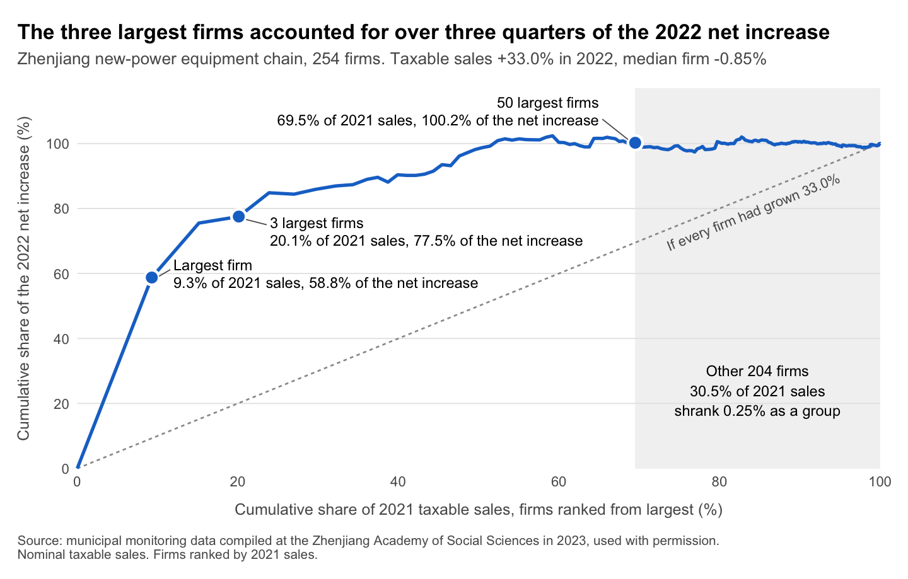

# How broad was the 2022 boom in Zhenjiang's new-power equipment chain?

In 2022 the taxable sales of the 254 firms on the register of Zhenjiang's new-power (new-energy) equipment chain rose by 33.0%, the fastest growth among the city's eight priority chains (Zhu and Yang, 2023). Sales of all the city's industrial firms above designated size rose by 7.9%. The median firm in the chain, however, sold 0.85% less than in 2021, and 130 of the 254 firms recorded a decline.

I ranked the firms by their 2021 sales rather than their 2022 sales, so that a firm's rank does not depend on how much it grew. The three largest firms held 20.1% of chain sales in 2021 and accounted for 77.5% of the net increase in 2022, the two largest alone for 75.5%. The largest, a maker of silicon wafers for solar cells (Jiangsu Meike Solar Technology Inc., 2024), accounted for 58.8% by itself, while the third grew more slowly than the chain as a whole. The next 47 firms, ranked fourth to fiftieth, also grew as a group. Their combined sales rose by 15.2% and the median firm grew by 9.0%, although 21 of them recorded a decline and three accounted for more than half of the group's increase. The remaining 204 firms were flat as a group, at -0.25%, and their median firm shrank by 3.0%.

Concentrated sales growth does not by itself mean that Zhenjiang gained little. Studies of global production networks ask how much of the value created in these networks a region manages to capture (Coe et al., 2004). In Zhenjiang that would show up in purchases from local suppliers, in local jobs and wages, and in taxes, rather than in sales booked in the city. The sales records also cannot tell whether the firms ranked fourth to fiftieth grew on orders from the largest firms or on wider demand and higher prices. The next question I would examine is how much of the largest firms' additional purchasing went to suppliers that produce in Zhenjiang, by type of input. It would need those firms' purchase records for both years, with the place where each supplier produces.



## Data

I compiled these data in 2023 as a research assistant at the Zhenjiang Academy of Social Sciences. The Academy has allowed me to use them and to publish the results, including those for individual firms. The workbook itself is not public and is not in this repository.

The workbook comes from the city's monitoring of its priority industry chains for January to December 2022. Its second sheet lists the 254 firms on the chain's register in 2022, with each firm's taxable sales (应税销售) for 2022 and for the same period of 2021. Its first sheet is the summary table, which the script uses to check the chain total and to take the figures for all of the city's industrial firms above designated size (规上工业企业, those with annual main business revenue of 20 million yuan or more). The chain's total sales and growth in the workbook agree with the figures reported in the local press (Zhu and Yang, 2023). Sales are in current prices. The workbook reports them in 10,000 yuan, and the results are in 100 million yuan (亿元).

## What these data cannot show

- Sales are nominal, so price and volume changes are mixed together. Silicon prices for solar manufacturing reached a ten-year high in 2022 (Zhang, 2022).
- Sales are not value added. They include the cost of bought-in inputs, and a sale from one firm in the chain to another can be counted again in the buyer's sales.
- Taxable sales recorded for a firm in Zhenjiang need not all come from production in the city. The largest firm's prospectus (Jiangsu Meike Solar Technology Inc., 2024) shows that by the end of 2023, a year after the period studied, it made its silicon ingots in Inner Mongolia and Yunnan and cut them into wafers in Zhenjiang and Sichuan.
- Both years cover the firms on the chain's 2022 register, an administrative list, so firms that left the chain before 2022 are not counted.
- The results describe one year and do not identify causes.

## Reproducing the results

The code was run with R 4.4.3 on macOS, and package versions are pinned by renv. Put the workbook in `data/` as the only .xlsx file there and run these commands from the project folder.

```sh
Rscript -e 'renv::restore()'   # first time only
Rscript R/zj_chain_curve.R
```

A workbook stored elsewhere can be passed as an argument, as in `Rscript R/zj_chain_curve.R path/to/workbook.xlsx`. The script writes two tables and the figure to `output/`. Their columns and measures are described in [docs/outputs.md](docs/outputs.md).

## Definitions

- Firms are ranked by their 2021 sales, largest first. The data contain no ties.
- A firm's contribution to chain growth, in percentage points, is its increase divided by total chain sales in 2021 (461.64, in 100 million yuan), times 100. The contributions add up to the chain's 33.0.
- A firm's share of the net increase is its increase divided by the chain's net increase (152.37), times 100. The shares add up to 100, so a group's share can go above 100 when the other firms shrink on balance. The 50 largest firms account for 100.2%, and the cumulative curve peaks at 102.4% at the 32nd firm.
- Median growth is taken over firms with positive 2021 sales, since a growth rate needs a positive base. This covers 253 firms in the whole chain, all 47 firms ranked fourth to fiftieth and 203 of the other 204. The counts of firms whose sales fell use every firm in the group.
- Within the firms ranked fourth to fiftieth, the three with the largest increases accounted for 56.7% of the group's net increase.
- Further definitions, including the two measures of the top three firms' share, are in [docs/outputs.md](docs/outputs.md#further-definitions).

## Python version

`reference/make_reference.py` repeats the analysis in Python. It reads the same workbook, needs the openpyxl package and writes the two tables in `reference/`, which agree with the R tables in `output/` to six decimal places.

## References

- Coe, N.M., Hess, M., Yeung, H.W.-C., Dicken, P. and Henderson, J. (2004) ‘“Globalizing” regional development: a global production networks perspective’, *Transactions of the Institute of British Geographers*, 29(4), pp. 468–484. Available at: https://doi.org/10.1111/j.0020-2754.2004.00142.x.
- Jiangsu Meike Solar Technology Inc. (2024) *首次公开发行股票并在创业板上市招股说明书（注册稿）* [Prospectus for initial public offering and listing on the ChiNext board (registration draft)]. Available at: https://reportdocs.static.szse.cn/UpFiles/rasinfodisc1/202403/RAS_202403_301530905B104C509943CFB8D8928C077861E7.pdf (Accessed: 17 November 2026).
- Zhang, W. (2022) ‘光伏产业链价格迎来拐点 [Photovoltaic industry chain prices reach a turning point]’, *中国电子报* [China Electronics News], 30 December, p. 8. Available at: https://epaper.cena.com.cn/oldpaper/content/2022-12/30/content_763546.htm (Accessed: 17 November 2026).
- Zhu, J. and Yang, C. (2023) ‘镇江“双碳八大行动”调优能源结构 [Zhenjiang’s eight “dual carbon” actions optimise its energy structure]’, *镇江日报* [Zhenjiang Daily], 11 January. Available at: https://jsnews.jschina.com.cn/zj/a/202301/t20230111_3143509.shtml (Accessed: 17 November 2026).

Minghao Yang, November 2026
