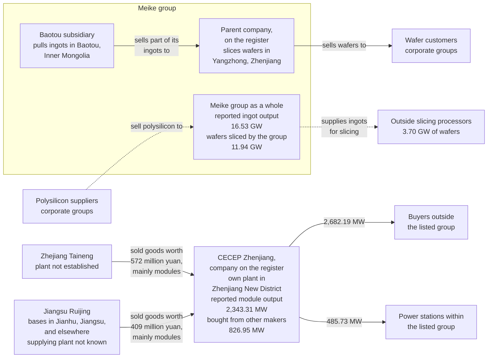

# Two firms behind the 2022 boom

Recorded sales, production networks and environmental reporting in Zhenjiang's new-power equipment chain

*Minghao Yang. The register data were compiled in 2023 during my research at the Zhenjiang Academy of Social Sciences; this note was completed in November 2026.*

## 1. The concentrated boom

Between 2021 and 2022 the taxable sales of the 254 firms on Zhenjiang's register for the new-power equipment chain rose by 33.0 per cent. The median firm, however, sold 0.85 per cent less, and 130 firms recorded a decline. Two companies account for most of the gap between the aggregate and the typical firm. The largest firm by 2021 sales, Jiangsu Meike Solar Technology Inc. (江苏美科太阳能科技股份有限公司), a maker of monocrystalline silicon ingots (单晶硅棒) and wafers registered in Yangzhong, contributed 58.8 per cent of the chain's net increase. The second largest, CECEP Solar Energy Technology (Zhenjiang) Co., Ltd. (中节能太阳能科技（镇江）有限公司), which makes solar cells and modules in Zhenjiang New District, contributed a further 16.8 per cent. Together they account for 75.5 per cent; the other 252 firms grew by 9.5 per cent as a group.

When two firms carry three quarters of the chain's growth, the meaning of the boom depends on what their recorded sales represent. Sales booked under a local company's name may reflect new manufacturing in the city, but also production elsewhere in a corporate group, goods bought from other makers or transactions between related companies. Both firms disclosed enough to examine these possibilities: Meike in a prospectus for a ChiNext listing (Jiangsu Meike Solar Technology Inc., 2024), and CECEP Zhenjiang through the reports of its listed parent and the parent's reply of November 2023 to questions from the Shenzhen Stock Exchange (CECEP Solar Energy Co., Ltd., 2023c).

## 2. What was produced, purchased and recorded?

Table 1. Sales and revenue by reporting boundary, in 100 million yuan

| Firm | Scope | 2021 | 2022 | Source |
|---|---|---|---|---|
| Meike | Taxable sales on the register | 42.86 | 132.39 | Derived from the rank table in this repository |
| Meike | Consolidated revenue of the group | 36.12 | 129.00 | Jiangsu Meike Solar Technology Inc. (2024, p. 1-1-27) |
| CECEP Zhenjiang | Taxable sales on the register | 27.09 | 52.62 | Derived from the rank table in this repository |
| CECEP Zhenjiang | Revenue in the company's own accounts | 28.78 | 58.01 | CECEP Solar Energy Co., Ltd. (2022a, p. 206; 2023a, p. 26) |
| Listed parent | Zhenjiang region line, net of internal sales | 26.08 | 49.17 | CECEP Solar Energy Co., Ltd. (2023a, p. 15) |
| Listed parent | Solar product manufacturing segment, net of internal sales | 25.49 | 48.57 | CECEP Solar Energy Co., Ltd. (2023a, p. 15) |

Ratios and growth rates in the text are calculated from unrounded figures.

The register lists Meike's parent company in Yangzhong, yet that entity's taxable sales equal about 119 per cent of the group's consolidated revenue in 2021 and 103 per cent in 2022 (Table 1). The register does not say whether this figure covers only the parent's own sales, which would include any sales to other group companies, or also the sales of those companies. Either way, one local entry carries turnover on the scale of the whole group. In 2022 the group's ingots were pulled in Baotou, Inner Mongolia, by a subsidiary that sold part of its output to the parent, and the parent sliced wafers in Yangzhong. The group's ingot plant in Mengzi, Yunnan, and its slicing plant in Meishan, Sichuan, did not start production until the second half of 2023 (Jiangsu Meike Solar Technology Inc., 2024, pp. 1-1-62, 1-1-145, 1-1-164 to 1-1-165). Ingot output is reported only for the group as a whole, 16.53 GW in 2022 (Jiangsu Meike Solar Technology Inc., 2024, p. 1-1-157). Because ingot capacity had outgrown slicing capacity, part of the slicing, the stage carried out in Yangzhong, was done by other firms. Of the group's 15.63 GW of wafers, 11.94 GW were sliced by the group, including some on commission for customers, and 3.70 GW by outside processors. By number of wafers, the outsourced share was 22.77 per cent (Jiangsu Meike Solar Technology Inc., 2024, p. 1-1-158). The prospectus's list of major processing contracts names one processor, Leshan Gaoce New Energy Technology (乐山高测新能源科技有限公司), which sliced wafers for the parent under contracts running to June 2022 (Jiangsu Meike Solar Technology Inc., 2024, pp. 1-1-374 to 1-1-375). It does not say how much of the outsourced volume this firm handled or where the slicing took place.

CECEP Zhenjiang shows a different gap between recorded and physical output. The 2022 annual report of its listed parent gives module production of 2,684.53 MW in 2022 and 1,786.12 MW in 2021, an increase of 50.3 per cent (CECEP Solar Energy Co., Ltd., 2023a, p. 16). I compare these figures with the reply to the exchange, which divides the same business into four components (Table 2). The two documents reconcile exactly, but by different rules in the two years. For 2022,

2,343.31 + 826.95 − 485.73 = 2,684.53 MW,

so the annual report's production equals reported output plus purchases less internal use, and its sales equal sales outside the listed group alone. For 2021, production equals reported output plus purchases, and sales include internal use. The annual report does not identify a change of basis; I infer it from this reconciliation. On the reply's consistent definitions, the company's growth in 2022 was 40.4 per cent in reported output, 63.6 per cent in sales outside the listed group and 77.7 per cent once internal use is added.

Table 2. CECEP Zhenjiang module volumes, in megawatts

| Measure | 2021 | 2022 | Source |
|---|---|---|---|
| Reported module output | 1,668.97 | 2,343.31 | CECEP Solar Energy Co., Ltd. (2023c, p. 1-43) |
| Purchased from other makers | 117.15 | 826.95 | CECEP Solar Energy Co., Ltd. (2023c, p. 1-43) |
| Used in the listed group's power stations | 143.07 | 485.73 | CECEP Solar Energy Co., Ltd. (2023c, p. 1-43) |
| Sold outside the listed group | 1,639.38 | 2,682.19 | CECEP Solar Energy Co., Ltd. (2023c, p. 1-43) |
| Production in the annual report | 1,786.12 | 2,684.53 | CECEP Solar Energy Co., Ltd. (2023a, p. 16) |
| Sales in the annual report | 1,782.45 | 2,682.19 | CECEP Solar Energy Co., Ltd. (2023a, p. 16) |

Purchases account for much of the spread between these growth rates. The company's own capacity expanded, with a 1.5 GW module line in Zhenjiang New District starting production in August 2022 (CECEP Solar Energy Co., Ltd., 2023a, pp. 77 to 78), but bought-in modules rose sevenfold and supplied 26.1 per cent of the modules available to the company in 2022, against 6.6 per cent in 2021. Of the 1,384.14 MW rise in available modules, purchases contributed 709.80 MW and reported output 674.34 MW. The reply names two suppliers, both founded in 2021. In 2022 the company bought goods worth 572 million yuan, mainly modules, from Zhejiang Taineng Photoelectric (浙江泰能光电有限公司) and 409 million yuan from Jiangsu Ruijing Solar (江苏瑞晶太阳能科技有限公司), including value added tax (CECEP Solar Energy Co., Ltd., 2023c, p. 1-42). The reply also mentions contract manufacturing among the purchases from the two firms (CECEP Solar Energy Co., Ltd., 2023c, p. 1-44) without saying whether any of it is counted in reported output. Where the purchased modules were made is not established; Ruijing reported bases in Jianhu, Jiangsu, and at a second site (OFweek, 2022). Figure 1 brings together the relations that the filings document.

Figure 1. Production relations of the two firms in 2022. Arrows show sales or processing between entities, not delivery routes; dotted arrows join outside firms to the Meike group as a whole because the documents report these flows only for the group. Volumes are totals for a group or company, not plant output. For 2022 the prospectus names one outside processor and gives no volume by processor. The filings do not give the plants of suppliers or processors, the locations of customers, or the sites to which modules were delivered. Sources: Jiangsu Meike Solar Technology Inc. (2024, pp. 1-1-62, 1-1-157 to 1-1-158, 1-1-164 to 1-1-165, 1-1-374 to 1-1-375); CECEP Solar Energy Co., Ltd. (2023a, pp. 77 to 78; 2023c, pp. 1-42 to 1-44); OFweek (2022).

## 3. Financial returns and environmental evidence

Rapid sales growth came with very different financial returns at two stages of the solar industry. Meike's consolidated net profit rose almost fivefold, from 0.20 billion to 0.99 billion yuan, at a gross margin of about 12 per cent on its main business (Jiangsu Meike Solar Technology Inc., 2024, pp. 1-1-27, 1-1-32). The prospectus does not report profit by entity for 2021 or 2022. In 2023 the Baotou subsidiary's own net profit equalled 59.5 per cent of the group's consolidated profit (Jiangsu Meike Solar Technology Inc., 2024, pp. 1-1-62 to 1-1-65). Because the subsidiary's accounts include its sales to the parent, this compares sizes rather than shares, but profits on that scale were recorded by an entity in Inner Mongolia.

CECEP Zhenjiang doubled its revenue and remained loss-making. Its own accounts show losses of 116 million yuan in 2021 and 36 million in 2022 (CECEP Solar Energy Co., Ltd., 2022a, p. 206; 2023a, p. 26). After transactions within the listed group are eliminated, the reply reports losses of 167 million and 131 million yuan for the manufacturing business (CECEP Solar Energy Co., Ltd., 2023c, p. 1-20).

Electricity supplies about 80 per cent of the energy used in making solar panels, most of it at the polysilicon, ingot and wafer stages (International Energy Agency, 2022, p. 8). Meike reports purchased electricity and water for direct production at group level; electricity rose from 412 GWh in 2021 to 1,051 GWh in 2022 (Jiangsu Meike Solar Technology Inc., 2024, p. 1-1-164). The prospectus states that this consumption arises mainly in ingot production, the stage carried out in Baotou in 2022, but it gives no division by site (Jiangsu Meike Solar Technology Inc., 2024, p. 1-1-165).

Of the reports cited here, only the 2022 annual report gives carbon dioxide emissions for CECEP Zhenjiang, putting those from its purchased electricity in 2022 at 57,450 tonnes (CECEP Solar Energy Co., Ltd., 2023a, p. 47). Its discharge disclosures begin in the same year, when the company first appears as a key discharge unit (CECEP Solar Energy Co., Ltd., 2022a, p. 50; 2022b, p. 21). The tables cover six water pollutants at the company's single wastewater outlet, from which wastewater treated on site goes to a municipal treatment plant (CECEP Solar Energy Co., Ltd., 2022b, p. 21; 2024, p. 49). No report states the period or method behind the discharge totals, four of the six half-year totals for 2022 are larger than the annual totals, and the half-year and annual reports for 2023 print identical totals and concentrations for all six pollutants (CECEP Solar Energy Co., Ltd., 2022b, p. 21; 2023a, p. 46; 2023b, p. 24; 2024, p. 49). As a result, the tables cannot show how discharges from the outlet changed while the company's output grew.

## 4. Discussion

Studies of global production networks distinguish the places where value is created from those where it is captured, and relate regional development to the way local firms are coupled to wider networks (Coe et al., 2004; Yeung, 2009). The Zhenjiang register records something narrower than either, the taxable sales of a locally registered entity. In these two cases that entity occupies different positions in the network. Meike's parent slices and sells wafers at the end of an intra-group chain, in a group whose profit rose almost fivefold. CECEP Zhenjiang makes modules and also buys them from other makers to sell with its own, and it remained loss-making.

Zhenjiang's daily newspaper reported the chain's 33 per cent growth in an article on the city's actions for carbon peaking and neutrality, which presents new-power equipment and new energy as an important measure in the city's green and low-carbon development (Zhu and Yang, 2023). Growth in the taxable sales of the chain as a whole need not mean that production in the city grew at the same rate. At CECEP Zhenjiang, reported module output rose by 40 per cent in 2022, while the modules it sold, or delivered to the listed group's own power stations, rose by 78 per cent.

In both firms, the sales recorded in Zhenjiang rested in part on output made by other entities. At Meike these were its ingot subsidiary in Inner Mongolia and, for part of the group's wafers, outside slicers whose slicing sites are not given. At CECEP Zhenjiang they were other module makers, which supplied about a quarter of the modules the company handled in 2022. The chain's headline growth therefore shows which firms in Zhenjiang booked the turnover. The production behind it, and the electricity and discharges that came with it, have to be traced firm by firm. So do the wages, profits and taxes on which any judgement of the value Zhenjiang captured would rest.

Data and calculations: figures from published sources are listed with their source, printed page and table in `evidence/public_figures.csv`, and figures from the register come from the two tables in `output/`. `R/two_firm_ratios.R` and `reference/two_firm_reference.py` compute the derived figures and check the reconciliations reported here.

## References

CECEP Solar Energy Co., Ltd. (2022a) *2021年年度报告* [2021 annual report]. Available at: https://disc.static.szse.cn/disc/disk03/finalpage/2022-04-15/355b7490-2df5-4703-bce4-f399696df601.PDF (Accessed: 1 November 2026).

CECEP Solar Energy Co., Ltd. (2022b) *2022年半年度报告* [2022 half-year report]. Available at: https://static.cninfo.com.cn/finalpage/2022-08-26/1214408004.PDF (Accessed: 1 November 2026).

CECEP Solar Energy Co., Ltd. (2023a) *2022年年度报告* [2022 annual report]. Available at: https://disc.static.szse.cn/disc/disk03/finalpage/2023-04-12/6e4c6283-e125-4058-b630-9f316855b557.PDF (Accessed: 1 November 2026).

CECEP Solar Energy Co., Ltd. (2023b) *2023年半年度报告* [2023 half-year report]. Available at: https://disc.static.szse.cn/disc/disk03/finalpage/2023-08-25/b9dff8c8-eac5-4982-a15b-efa32111b341.PDF (Accessed: 1 November 2026).

CECEP Solar Energy Co., Ltd. (2023c) *关于中节能太阳能股份有限公司申请向不特定对象发行可转换公司债券的审核问询函的回复（修订稿）* [Reply to the review inquiry letter on the application to issue convertible bonds to unspecified investors (revised)], 29 November. Available at: https://static.cninfo.com.cn/finalpage/2023-11-29/1218467941.PDF (Accessed: 1 November 2026).

CECEP Solar Energy Co., Ltd. (2024) *2023年年度报告* [2023 annual report]. Available at: https://static.cninfo.com.cn/finalpage/2024-04-13/1219598211.PDF (Accessed: 1 November 2026).

Coe, N.M., Hess, M., Yeung, H.W.-C., Dicken, P. and Henderson, J. (2004) ‘“Globalizing” regional development: a global production networks perspective’, *Transactions of the Institute of British Geographers*, 29(4), pp. 468–484. Available at: https://doi.org/10.1111/j.0020-2754.2004.00142.x.

International Energy Agency (2022) *Special report on solar PV global supply chains*. Paris: IEA. Available at: https://iea.blob.core.windows.net/assets/d2ee601d-6b1a-4cd2-a0e8-db02dc64332c/SpecialReportonSolarPVGlobalSupplyChains.pdf (Accessed: 1 November 2026).

Jiangsu Meike Solar Technology Inc. (2024) *首次公开发行股票并在创业板上市招股说明书（注册稿）* [Prospectus for initial public offering and listing on the ChiNext board (registration draft)]. Available at: https://reportdocs.static.szse.cn/UpFiles/rasinfodisc1/202403/RAS_202403_301530905B104C509943CFB8D8928C077861E7.pdf (Accessed: 1 November 2026).

OFweek (2022) ‘瑞晶太阳能参评“维科杯·OFweek 2022年度光伏行业超高效光伏组件奖” [Ruijing Solar enters the OFweek 2022 award for high-efficiency modules]’, *OFweek太阳能光伏网* [OFweek Solar], 16 August. Available at: https://solar.ofweek.com/2022-08/ART-260008-8120-30571455.html (Accessed: 1 November 2026).

Yeung, H.W.-C. (2009) ‘Regional development and the competitive dynamics of global production networks: an East Asian perspective’, *Regional Studies*, 43(3), pp. 325–351. Available at: https://doi.org/10.1080/00343400902777059.

Zhu, J. and Yang, C. (2023) ‘镇江“双碳八大行动”调优能源结构 [Zhenjiang’s eight “dual carbon” actions optimise its energy structure]’, *镇江日报* [Zhenjiang Daily], 11 January. Available at: https://jsnews.jschina.com.cn/zj/a/202301/t20230111_3143509.shtml (Accessed: 1 November 2026).
